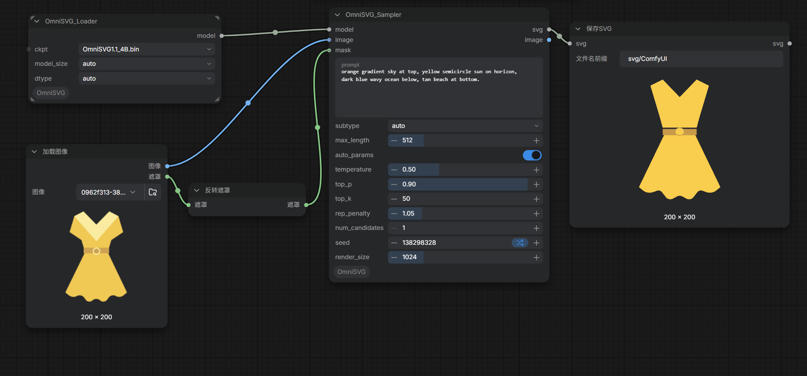

# ComfyUI_OmniSVG
[OmniSVG](https://github.com/OmniSVG/OmniSVG): A Unified Scalable Vector Graphics Generation Model,you  can try it in ComfyUI.


# Update
* 重新封装方法，改用简单版本的svg后端（svg保存用comfyUI原生的）/ repackage method, change to a simple svg backend（svg save use the original ComfyUI）
---

# 1 . Installation /安装

In the ./ComfyUI /custom_nodes directory, run the following:   
```
git clone https://github.com/smthemex/ComfyUI_OmniSVG.git
```

# 2 . Requirements  
```
pip install -r requirements.txt
```

# 3. Models
* [OmniSVG/OmniSVG1.1_8B](https://huggingface.co/OmniSVG/OmniSVG1.1_8B) download / 下载pytorch_model.bin后改名，
* [OmniSVG/OmniSVG1.1_4B](https://huggingface.co/OmniSVG/OmniSVG1.1_4B/tree/main) download / 下载pytorch_model.bin后改名，

  ```
  |   ├──you comfyui/models/text_encoders/
  |       ├──OmniSVG1.1_8B.bin or OmniSVG1.1_4B.bin 
  ```

# 4. Tips
* 文生矢量和图生矢量，连图则图，无图则文。

# 5 .Example
* 


# 6. Citation
```
@article{yang2025omnisvg,
  title={OmniSVG: A Unified Scalable Vector Graphics Generation Model}, 
  author={Yiying Yang and Wei Cheng and Sijin Chen and Xianfang Zeng and Jiaxu Zhang and Liao Wang and Gang Yu and Xinjun Ma and Yu-Gang Jiang},
  journal={arXiv preprint arxiv:2504.06263},
  year={2025}
}

```
